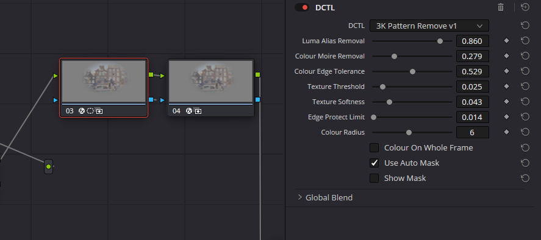
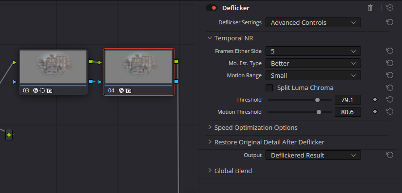

# 3K Pattern Remove

A DCTL for DaVinci Resolve that reduces aliasing and colour moire on fine patterns (brick, mesh, tiles, fabric). It was tuned on SIGMA fp 3K open gate CinemaDNG. In that mode fine detail folds into false stripes that shimmer in motion and turn into colour bands and artifacts once saturation is pushed. It also works on other footage with the same kind of false pattern.

> **Note:** the settings are very specific to my test footage and still need a lot more testing. I'm sharing it in case it's useful to anyone else.

## Test video

[](https://youtu.be/ahF3GCAReFM)

▶ [Watch the before / after test on YouTube](https://youtu.be/ahF3GCAReFM)

## Install

1. Download **[3K-Pattern-Remove-v1.zip](https://github.com/sdesfe/gyroflow-2060/raw/main/3k-pattern-remove/3K-Pattern-Remove-v1.zip)** and unzip it. It contains the DCTL and the installers.
2. Run the installer:
   * **Windows:** right-click `Install-Windows.bat` and choose **Run as administrator**.
   * **macOS:** double-click `Install-macOS.command`. If macOS blocks it, right-click it and choose Open. Not tested yet.
3. Restart DaVinci Resolve. On the Color page, open Effects, drag **DCTL** onto a node, and choose **3K Pattern Remove > 3K Pattern Remove v1** in its DCTL list.

The same files are also in the [`3k-pattern-remove/files`](3k-pattern-remove/files/) folder if you want only the `.dctl`.

## Node tree

The DCTL handles the pattern inside each frame. The shimmer that remains in motion is handled by Resolve's Deflicker on the next node. Put both at the start of the tree, before any grade:

```
[Camera Raw] → 1. 3K Pattern Remove (DCTL) → 2. Deflicker (Resolve FX) → your grade …
```

The screenshots below come from my own grade, where these two sit as nodes 03 and 04. In your tree they should be node 1 and node 2.

Keep Camera Raw sharpening low. Sharpening before node 1 makes the false pattern stronger. In my grade, the rest of the setup is:

* **Camera Raw tab:** Noise Reduction between 5 and 10. It calms the fine noise that otherwise gets read as false pattern.
* **Later nodes:** only a slight sharpen, after the pattern is removed, so the clean image gets sharpened and not the moire.

### Node 1: 3K Pattern Remove v1

The default values are the ones that worked on my own footage (SIGMA fp 3K, brick facades). Adjust them to yours, and use Show Mask to see where it acts.

How it works:
1. **Luma stage:** it removes the 2 to 5 pixel band where aliasing sits, inside an automatic mask that finds fine texture and skips strong edges.
2. **Colour stage:** it smooths the colour channels across a wider area. It is edge-aware, judged relative to local brightness, so colour moves across brick mortar but not across window frames.



### Node 2: Deflicker (Resolve FX), settings used

| Setting | Value |
|---|---|
| Deflicker Settings | Advanced Controls |
| Temporal NR, Frames Either Side | 5 |
| Mo. Est. Type | Better |
| Motion Range | Small |
| Split Luma Chroma | off |
| Threshold | 79.1 |
| Motion Threshold | 80.6 |
| Speed Optimization: Reduced-Detail Motion / Limit Analysis Area | off / off |
| Restore Original Detail: Detail to Restore | 0.030 |
| Output | Deflickered Result |



### Masking: isolate the problem area

Limit both nodes to the problem area with a soft window (tracked if the camera moves). I use a circle window on node 1, which node 2 receives as its key. Over the whole frame, water, leaves and other moving texture start to look artificial.

## Render time

Rendering my test clip took **6 s before and 1:19 after** this node tree. Use a timeline proxy or render cache while editing.

## Why this isn't a single DCTL

A DCTL only sees the current frame. The shimmer changes from frame to frame, so removing it needs the neighbouring frames, which is what Deflicker does. That's why it stays a separate node.

## Also here: Gyroflow fpSup 2060 v4 (stabilization for DaVinci Resolve)

My own version of the Gyroflow stabilization plugin [fpSup](https://github.com/ijigen/gyroflow-plugins) v0.1.9 by Bei, with the default settings I like and tuned for my laptop to stop constant crashes.

**[⬇ Download Gyroflow fpSup 2060 v4 (Windows)](https://github.com/sdesfe/gyroflow-2060/raw/main/gyroflow-fpsup-2060-v4/Gyroflow-fpSup2060v4-OpenFX-windows.zip)**

My laptop: Gigabyte AERO 15 (i7-9750H with Intel UHD 630 + RTX 2060 6 GB, 16 GB RAM), Windows 11, Resolve Studio 21.1 in CUDA mode.

### Why it crashed

* **Intel GPU driver:** the plugin opened the Intel Vulkan driver, even with the Intel GPU disabled in Resolve, and that driver crashed Resolve.
* **Thumbnails and parallel renders:** Resolve rendered the viewer and tiny thumbnails of the same clip at the same time through CUDA memory sharing, and Resolve crashed soon after.
* **Leftovers:** OpenCL drivers and a background update thread that could still be running when Resolve closed the plugin.

### What's different from fpSup v0.1.9

**Custom defaults**
* Smoothness: 2
* Zooming: Static
* Disable Gyroflow's stretch: on
* Loading a project or clip keeps these values instead of overwriting them with the project's own.

**Stability changes**
* Render thread safety is set to InstanceSafe, so Resolve renders each clip's effect one frame at a time.
* OpenCL is never used, so no OpenCL drivers get loaded, Intel's included. Rendering is CUDA + Vulkan on the NVIDIA GPU.
* No update checks and no background update thread.
* Own name, ID and folder ("Gyroflow (fpSup 2060 v4)"), so it installs next to other fpSup versions without replacing them.

### Install (Windows)

1. Close DaVinci Resolve.
2. Download **[Gyroflow-fpSup2060v4-OpenFX-windows.zip](https://github.com/sdesfe/gyroflow-2060/raw/main/gyroflow-fpsup-2060-v4/Gyroflow-fpSup2060v4-OpenFX-windows.zip)** and unzip it.
3. Right-click `Install-Windows.bat` and choose **Run as administrator**.
4. In Resolve, add **Gyroflow (fpSup 2060 v4)** from the OpenFX effects.

### Recommended on laptops with Intel + NVIDIA graphics

The plugin can still load the Intel Vulkan driver (`igvk64.dll`), which crashed Resolve on my machine. Hide it with a Windows user environment variable:

```
VK_LOADER_DRIVERS_DISABLE = *igvk*
```

To set it, search "environment variables" in Start, choose "Edit environment variables for your account", click New, then restart Resolve. Only Vulkan apps are affected, and they use the NVIDIA GPU instead.

---

*Disclaimer: made with the assistance of Claude (Anthropic) for the text and design.*
